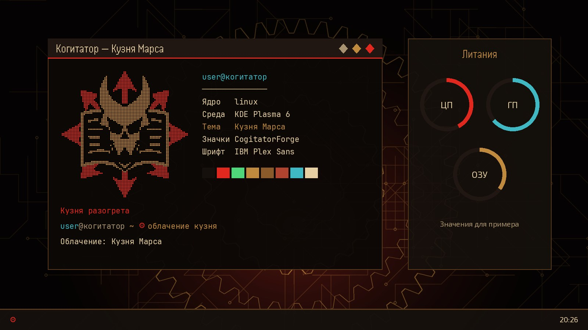
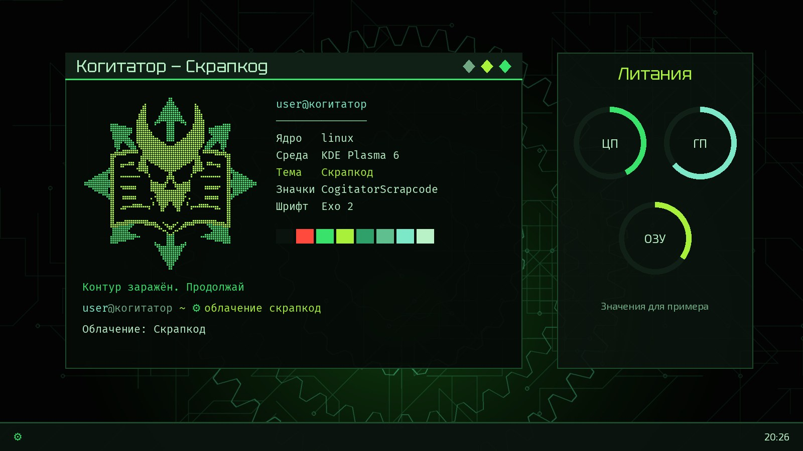

# Cogitator

A KDE Plasma 6 theme with two looks that switch with one command. [Русская версия](README.ru.md)

| Кузня Марса (Forge of Mars) | Скрапкод (Scrapcode) |
|---|---|
|  |  |

*Illustrations built from the theme's real wallpaper, palette, fonts and emblem by `docs/make_previews.py`. They are not screenshots.*

The interface and the commands are in Russian.

## What it themes

| Area | Details |
|---|---|
| Plasma | color schemes, desktop theme, icons, cursors, Aurorae window decorations, fonts, wallpapers |
| Widgets | `Литания`: circular CPU/GPU/RAM monitor; `Облачение`: theme switcher |
| Terminals | Ghostty (with shaders), Alacritty, Konsole |
| Tools | VS Code colors, btop, fastfetch, fish prompt |
| Notifications | `cogitator-herald` user service: USB devices, low battery, overheating, network loss |
| Boot and login | optional, Plasma Login Manager only |

## Requirements

KDE Plasma 6 and the fish shell. **Developed and tested on one machine only: CachyOS, Plasma 6.8.2.** Arch-based systems get their packages installed automatically. On other distributions the installer lists what is missing, and you install it yourself; this path has not been tested.

## Install

```sh
git clone https://github.com/Isthsharius/cogitator.git
cd cogitator
./install.sh                 # applies Кузня; add --look скрапкод for the other look
```

Flags: `--look кузня|скрапкод`, `--no-apply` (install only), `--no-deps` (skip pacman).

Then open a new fish terminal. Add the widgets by hand: right-click the panel → *Add Widgets* → `Литания`, `Облачение`.

### What the installer changes

The previous state is saved once in `~/.local/share/cogitator-theme/pre-state`. Then the installer:

- replaces the color sections of `~/.config/alacritty/alacritty.toml`
- sets `workbench.colorCustomizations` in VS Code settings
- makes `Cogitator.profile` the default Konsole profile
- adds one `config-file` line to `~/.config/ghostty/config`
- enables the `cogitator-herald` user service

To undo all of it, run `вернуть-облик`.

### Options

| What | How |
|---|---|
| Your own wallpaper | `COGITATOR_WALLPAPER=/path/to/image.png ./install.sh` (without it, a wallpaper is generated by `wallpaper.py`) |
| Wrong-password joke in `sudo` | `COGITATOR_SUDOERS=1 ./install.sh`, adds `/etc/sudoers.d/cogitator`; off by default |
| Boot splash and login screen | after installing: `sudo bash ~/.cache/cogitator-theme/build/boot/setup.sh install` (needs Plymouth and `plasmalogin`; `revert` undoes it) |

## Commands

| Command | Action |
|---|---|
| `облачение [кузня\|скрапкод]` | switch theme; with no argument, toggle |
| `облачение --проверка` | check that the theme is intact, useful after Plasma updates |
| `вернуть-облик` | restore the look from before installation and remove the theme |
| `манифест` / `литания` | fastfetch / btop in theme colors |
| `обряд` / `очищение` | update the system / clean package cache (Arch-based only) |
| `бдение` / `перерождение` | power off / reboot, with confirmation |

## Development

```sh
python3 -m unittest discover -s tests
python3 build.py && python3 docs/make_previews.py
```

Everything is generated from one palette in `build.py`. GPU temperature alerts need `nvidia-smi` and stay silent without it.

## Credits and license

- Fonts: Handjet, Tektur and Exo 2 are under the SIL Open Font License; see `fonts/OFL-*.txt`.
- Fan-made. Not affiliated with or endorsed by Games Workshop.
- Code: MIT, see `LICENSE`.
