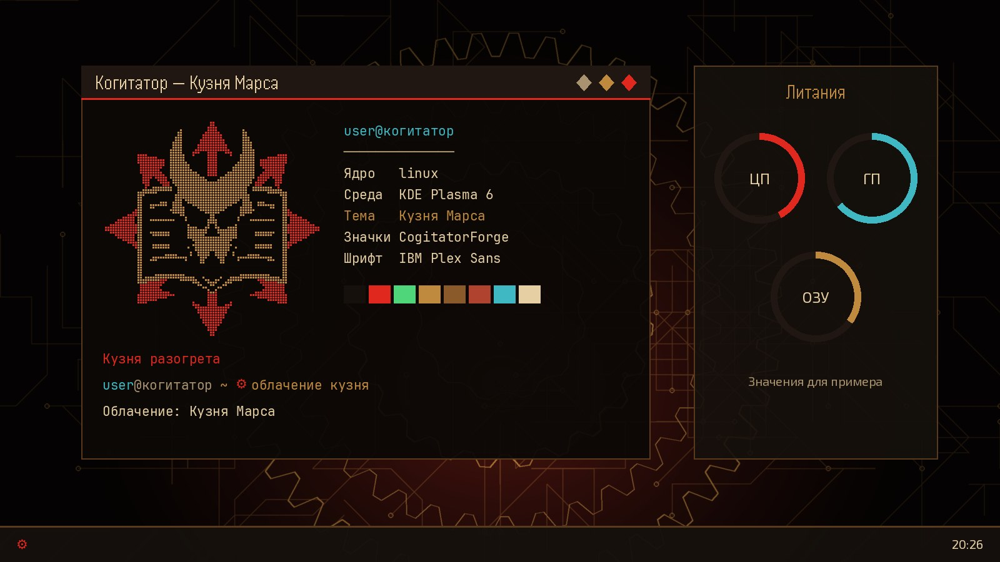
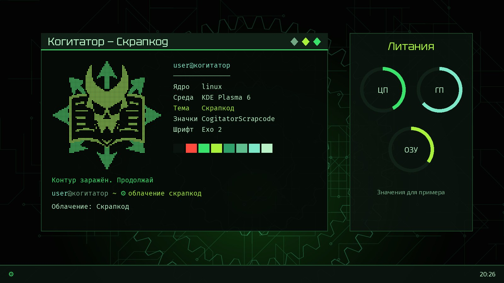

# Cogitator

Тема для KDE Plasma 6 с двумя оформлениями, которые меняются одной командой. [English](README.md)

| Кузня Марса | Скрапкод |
|---|---|
|  |  |

*Иллюстрации собраны скриптом `docs/make_previews.py` из настоящих обоев, палитры, шрифтов и эмблемы темы. Это не снимки экрана.*

## Что оформляется

Цвета Plasma, тема рабочего стола, значки, курсоры, рамки окон, шрифты, обои. Виджеты `Литания` (кольца ЦП, ГП, ОЗУ) и `Облачение` (смена темы). Ghostty с шейдерами, Alacritty, Konsole, VS Code, btop, fastfetch, приглашение fish. Служба уведомлений `cogitator-herald`. По желанию: заставка загрузки и экран входа.

## Требования

KDE Plasma 6 и fish. **Разработано и проверено на одной машине: CachyOS, Plasma 6.8.2.** В Arch-подобных системах пакеты ставятся сами. В других дистрибутивах установщик перечислит, чего не хватает, а поставить это нужно вручную; такой путь не проверялся.

## Установка

```sh
git clone https://github.com/Isthsharius/cogitator.git
cd cogitator
./install.sh                 # включит Кузню; для другой темы: --look скрапкод
```

Флаги: `--look кузня|скрапкод`, `--no-apply` (только установить), `--no-deps` (не ставить пакеты).

Затем откройте новый терминал fish. Виджеты добавляются вручную: правый клик по панели → «Добавить виджеты» → `Литания`, `Облачение`.

### Что изменит установщик

Прежнее состояние один раз сохраняется в `~/.local/share/cogitator-theme/pre-state`. Затем установщик:

- заменит секции цветов в `~/.config/alacritty/alacritty.toml`
- задаст `workbench.colorCustomizations` в настройках VS Code
- сделает `Cogitator.profile` профилем Konsole по умолчанию
- добавит строку `config-file` в `~/.config/ghostty/config`
- включит пользовательскую службу `cogitator-herald`

Всё это отменяет команда `вернуть-облик`.

### Настройки

| Что | Как |
|---|---|
| Свои обои | `COGITATOR_WALLPAPER=/путь/к/картинке.png ./install.sh` (без этого обои рисует `wallpaper.py`) |
| Шутка про неверный пароль в `sudo` | `COGITATOR_SUDOERS=1 ./install.sh`, добавит `/etc/sudoers.d/cogitator`; по умолчанию выключено |
| Заставка и экран входа | после установки: `sudo bash ~/.cache/cogitator-theme/build/boot/setup.sh install` (нужны Plymouth и `plasmalogin`; `revert` отменяет) |

## Команды

| Команда | Действие |
|---|---|
| `облачение [кузня\|скрапкод]` | сменить тему; без аргумента переключить |
| `облачение --проверка` | проверить целостность темы, полезно после обновления Plasma |
| `вернуть-облик` | вернуть прежний вид и удалить тему |
| `манифест` / `литания` | fastfetch / btop в цветах темы |
| `обряд` / `очищение` | обновить систему / почистить кэш пакетов (только Arch-подобные) |
| `бдение` / `перерождение` | выключить / перезагрузить с подтверждением |

## Авторство и лицензия

- Шрифты Handjet, Tektur и Exo 2 распространяются по SIL Open Font License, см. `fonts/OFL-*.txt`.
- Фанатская работа, не связана с Games Workshop.
- Код: лицензия MIT, см. `LICENSE`.
